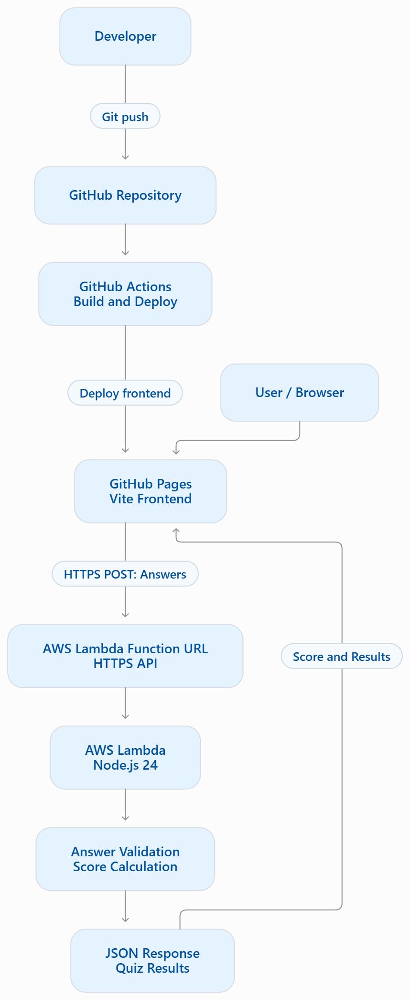

# CloudReady – AWS Exam Readiness Platform

CloudReady is a web-based AWS exam readiness platform that helps learners assess their understanding of AWS cloud concepts through practice questions, instant scoring, and performance feedback.

## Live Application

**Website:** https://naveenreddyps.github.io/aws-exam-readiness/

## Project Overview

CloudReady provides a simple practice environment for learners preparing for AWS certification exams.

The application presents 20 sample AWS questions across different cloud topics. Users can select answers, submit their responses, and receive an automatically calculated score.

Correct answers and explanations are handled by the backend rather than exposed in the frontend.

*Note: Questions are for learning purposes and are not official AWS exam questions.*

## Key Features

- 20 AWS practice questions
- Multiple-choice answers
- Question navigation
- Automatic score calculation
- Backend-side answer validation
- Immediate result feedback
- Restart functionality
- Responsive web interface

## Technology Stack

| Component | Technology |
|---|---|
| Frontend | HTML, CSS, JavaScript |
| Frontend build tool | Vite |
| Backend | Node.js |
| Serverless compute | AWS Lambda |
| API | Lambda Function URL |
| Version control | Git and GitHub |
| Hosting | GitHub Pages |
| CI/CD | GitHub Actions |

## AWS Services Used

- **AWS Lambda:** Executes backend quiz logic and calculates scores.
- **Lambda Function URL:** Exposes the backend through an HTTPS endpoint.

## Architecture



## Application Workflow

1. User opens the CloudReady website.
2. The frontend displays 20 AWS practice questions.
3. User selects answers and submits the quiz.
4. The frontend sends the answers to AWS Lambda.
5. Lambda validates the submitted answers.
6. Lambda calculates the score.
7. The backend returns the result as JSON.
8. The frontend displays the score.

## Run Locally

### Prerequisites

- Node.js
- npm
- Git

### Clone the repository

```bash
git clone https://github.com/NaveenReddyPS/aws-exam-readiness.git
cd aws-exam-readiness
```

### Install dependencies

```bash
npm install
```

### Start the frontend

```bash
npm run dev
```

Open:

```text
http://localhost:5173/
```

### Start the local backend

Open another terminal:

```bash
cd backend
node server.mjs
```

Local backend:

```text
http://127.0.0.1:3001
```

The deployed frontend uses the AWS Lambda Function URL configured in the frontend.

## Repository Structure

```text
aws-exam-readiness/
|
|-- .github/
|   |-- workflows/
|       |-- deploy.yml
|
|-- backend/
|   |-- index.mjs
|   |-- server.mjs
|   |-- test.mjs
|
|-- public/
|-- src/
|   |-- main.js
|   |-- style.css
|
|-- index.html
|-- package.json
|-- vite.config.js
|-- README.md
```

## Deployment

The frontend is deployed using GitHub Pages.

GitHub Actions automatically:

1. Checks out the repository.
2. Installs dependencies.
3. Builds the Vite application.
4. Uploads the production build.
5. Deploys the website to GitHub Pages.

The backend runs independently on AWS Lambda.

## Security Notes

- Quiz answers are validated on the backend.
- AWS credentials must never be committed to GitHub.
- The Lambda Function URL is publicly accessible for this demo.
- Production use would require additional abuse protection and security controls.

## Future Enhancements

- More AWS certification practice questions.
- Topic-wise performance analysis.
- User authentication and progress tracking.
- Question difficulty levels.
- Exam history and performance dashboard.
- Improved monitoring and error handling.

## Disclaimer

CloudReady is an independent educational project. It is not affiliated with or endorsed by Amazon Web Services.

---

**Developed as a hands-on AWS cloud learning project.**
